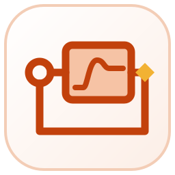
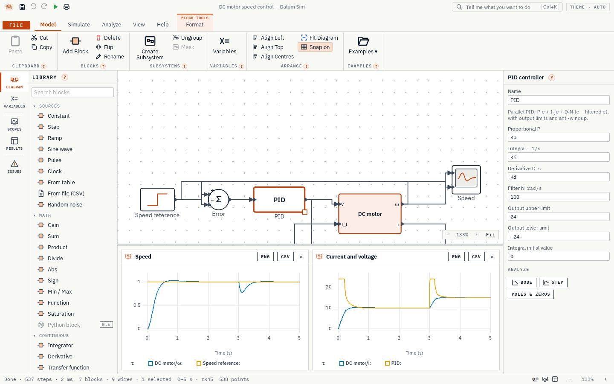
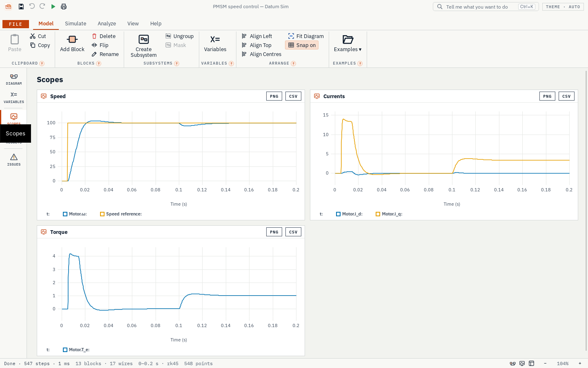

<p align="center"></p>

<h1 align="center">Datum Sim</h1>

<p align="center">Model and simulate dynamic systems: block diagrams, control and motors.</p>

<p align="center">
  <a href="https://github.com/Edgar-Mendonca/Datum-Sim/releases"></a>
  <a href="https://github.com/Edgar-Mendonca/Datum-Sim/actions/workflows/ci.yml"></a>
  
  
  
  
  
</p>

<p align="center">
  <a href="https://github.com/Edgar-Mendonca/Datum-Sim/releases/latest"></a>
  <a href="CHANGELOG.md"></a>
  <a href="docs/MEMORY.md"></a>
</p>



Draw a model as blocks and wires, press Run, and see how the system behaves over time. Datum Sim is for control, mechanical, electrical, process and mechatronics engineers, researchers and students. It is free and open source (MIT), Windows first, installs in seconds and updates itself.

## What it does

- **Block diagrams**: 84 blocks (sources, math, transfer functions, state space, PID, delays, discontinuities, lookup tables, scopes, discrete control, motors and drives). Wires find their own way around the blocks.
- **Discrete control**: discrete transfer function, state space, integrator and PID, rate transition; the diagram can colour every block by its sample time.
- **Motors**: DC (permanent-magnet, separately excited, shunt, series, compound), induction (squirrel-cage, double-cage, wound-rotor), synchronous (permanent-magnet, reluctance, wound-field with dampers), switched reluctance, BLDC and stepper motors, with typical values for low, medium and high voltage ratings.
- **Drives**: three-phase source, inverter (average or switched), DC link, PWM, Clarke and Park transforms, encoder, current sensor; worked examples from a direct-on-line start to field-oriented control.
- **Subsystems**: group blocks into one, open them, nest them; Goto/From tags send signals without wires.
- **Five solvers**: from fixed-step Euler to variable-step and stiff; the variable-step solvers find switching times exactly.
- **Live scopes**, parameter sweeps, results as CSV for Datum Plot.
- **Analysis** from the built-in Python engine: Bode plots and stability margins, step responses, poles and zeros, rise time, overshoot and settling time.
- **Checked**: the solvers, main blocks and motors are tested against known answers. See the verification records for [0.1.0](docs/verification/2026-10-27.md), [the motors](docs/verification/2026-10-28.md) and [discrete control](docs/verification/2026-10-29.md).



## Build from source

```bash
npm ci
npm run build:ui
cargo test --workspace
python -m pip install -r py/requirements.txt && python -m unittest discover -s py/tests
npx tauri dev            # run the app
```

Datum Sim is part of [Datum](https://edgar-mendonca.github.io/Datum/apps/sim), a family of free and open-source desktop tools for engineers, scientists, researchers and analysts. Its design guide is [FAMILY.md](https://github.com/Edgar-Mendonca/Datum/blob/HEAD/FAMILY.md); this repo's memory and roadmap are in [docs/MEMORY.md](docs/MEMORY.md).

Licence: [MIT](LICENSE). Third-party notices: [NOTICE](NOTICE).
